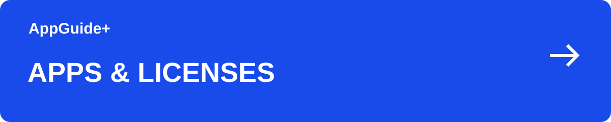

[이 분야의 안내](README.md) · [AppGuide+](https://github.com/appguideplus/app-guides#readme)

# Setapp 앱과 기기 관리: 새 Mac으로 옮길 때

앱을 설치할 수 있는 기기와 계정에 연결된 기기는 따로 확인해야 합니다. 로그아웃만으로 기기 연결이 해제되는 것은 아닙니다.

**[웹사이트에서 안내 보기 →](https://appguideplus.com/ko/setapp/devices/?utm_source=github)**

일부 웹 안내에는 제휴 링크가 포함됩니다. 해당 링크를 통한 구매·가입으로 운영자가 수수료를 받을 수 있습니다. AppGuide+는 독립 가이드입니다.

---

## 앱과 플랜을 함께 확인

사용할 앱이 어떤 운영체제에서 동작하는지 확인합니다. Mac에서 쓰던 앱이 iPhone이나 iPad에서도 같은 기능을 제공한다고 가정하지 마세요.

현재 플랜에 포함된 기기 수와 지원 기기 종류를 확인하세요. 개별 앱 구매와 Setapp 멤버십도 구분합니다.

<strong>새 기기 연결</strong>

## 새 기기 연결

새 Mac에서는 Setapp 데스크톱 앱에 로그인해 기기를 연결합니다. iPhone·iPad는 지원되는 iOS 앱을 설치하고 활성화하는 안내를 따릅니다.

연결 전 계정의 Device management에서 기존 기기를 확인하세요. 플랜 한도에 따라 새 기기 연결이 기존 기기에 영향을 줄 수 있습니다.

<strong>이전 기기 정리</strong>

## 이전 기기 정리

Setapp 또는 개별 앱에서 로그아웃하는 것만으로 계정의 기기 연결이 해제되지는 않습니다. 공식 기기 관리 화면에서 대상 기기를 확인하세요.

사용 중인 다른 사람이나 다른 Mac의 기기를 잘못 끊지 않도록 이름을 대조합니다. 앱에서 만든 문서와 설정은 별도로 보존하세요.

<strong>구독 전에 필요한 앱 검증</strong>

## 구독 전에 필요한 앱 검증

앱 목록에 있다는 사실뿐 아니라 필요한 기능과 기기에서 실제 사용 가능한지 확인합니다. 한 앱만 필요하다면 개별 이용 방식과 총비용도 비교하세요.

기기 연결 문제를 해결하려고 바로 상위 플랜을 선택하기 전에 현재 연결 상태부터 정리하세요.

<strong>함께 볼 안내</strong>

## 함께 볼 안내

- [Setapp 구독과 개별 앱 구매: Mac 앱 선택 가이드](setapp.ko.md)

<strong>출처와 확인일</strong>

## 출처와 확인일

- [기기 연결과 해제](https://support.setapp.com/hc/en-us/articles/360016876360-Manage-your-devices-Macs-iPhones-and-iPads)
- [현재 멤버십](https://setapp.com/membership)

내용 확인일: 2026-09-14. GitHub판 편집일: 2026-09-14.

AppGuide+가 작성한 독립적인 이용 안내이며, 각 서비스의 공식 고객지원 문서는 아닙니다.

---

[웹 안내로 이어가기](https://appguideplus.com/ko/setapp/devices/?utm_source=github) · [다른 안내 고르기](README.md)

읽기 구성 정리: 2026-10-23.
